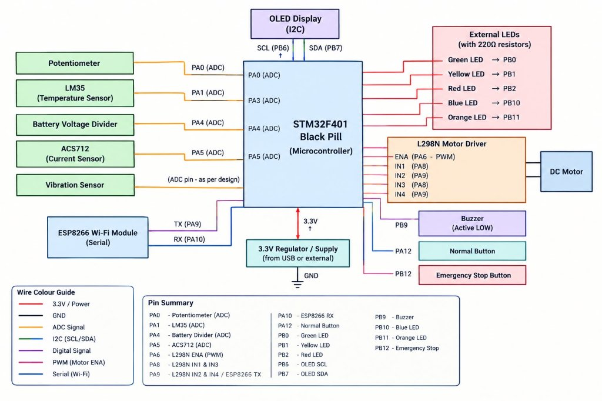

# ForgeSense: Intelligent Machine Monitoring and Control System

**Target MCU**: STM32F401CCU6 (ARM Cortex-M4 @ 16 MHz)  
**Programming Style**: Bare-metal register-level C  
**Primary Interface**: SSD1306 OLED, ESP8266 Wi-Fi, L298N DC Motor Drive, Sensor Suite  

---

## 1. System Overview
ForgeSense is a tabletop industrial condition monitoring prototype combining real-time multi-channel sensor acquisition, closed-loop DC motor control via PWM, local OLED display, wireless telemetry over USART, and an emergency-stop safety interlock.

---

## 2. Firmware Directory Organization
- `firmware/original/`: Exact historical motor control code (`potentiometer_dc_motor_control.c`).
- `firmware/modified/`: Intermediate versions including MPU6050 vibration monitoring (`ForgeSense_STM32_MPU6050_v2.c`).
- `firmware/corrected/`: Audited and bug-fixed motor control program (`potentiometer_dc_motor_control_corrected.c`).
- `firmware/final/`: Reconciled, production-ready integrated implementation (`ForgeSense_STM32_Final_Integrated.c`).
- `hardware/`: Hardware architecture and pin interconnect documentation.
- `documentation/`: Original case study PDF report.
- `testing/`: Verification procedure and checklist.

---

## 3. High-Priority Safety Interlock (Emergency Stop)
When the active-LOW emergency button on `PB12` is pressed:
1. TIM3 PWM duty cycle is immediately zeroed (`TIM3->CCR1 = 0`).
2. Motor direction pins (`PA8`, `PA9`) are de-energized.
3. Active-LOW buzzer on `PB9` is silenced (driven HIGH).
4. All sensor values are set to zero on the OLED display.
5. The system latches permanently into an irreversible safety lockout loop, rapidly toggling `PC13` and `PB0` (Red LED) at 5 Hz.
