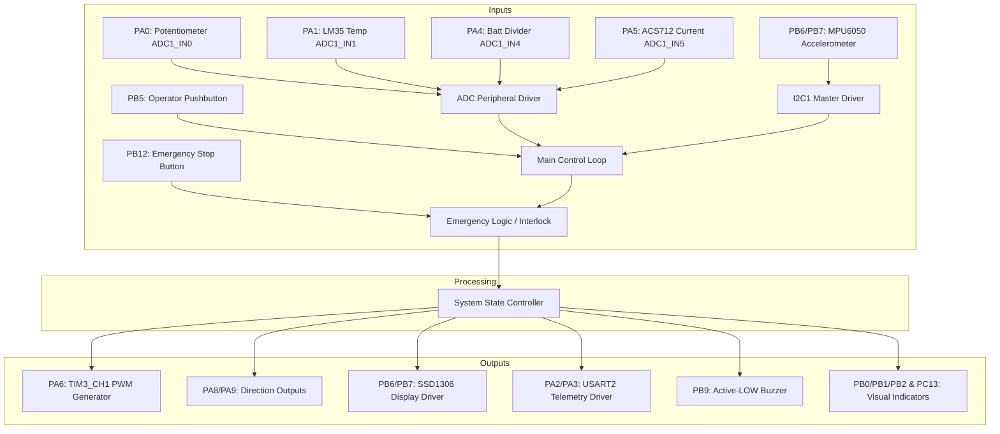

# Integration Audit & Module Interdependency Map

## 1. System Interdependency Model (ForgeSense)

---

## 2. Shared Peripheral Bus Considerations

### I2C1 Bus Arbitration (`PB6` SCL, `PB7` SDA)
* Both the **SSD1306 OLED** (`0x3C`) and the **MPU6050 IMU** (`0x68`) share the `I2C1` physical bus.
* *Audit Analysis*:
  1. The 7-bit addresses are non-overlapping (`0x3C != 0x68`).
  2. Because communication is single-threaded in the main superloop, transactions are sequential.
  3. Every I2C transaction properly terminates with a STOP condition (`I2C1->CR1 |= I2C_CR1_STOP;`), ensuring the bus returns to idle before subsequent slave communications.

### ADC Sequence Sequencing
* ADC1 is configured for software-triggered regular conversions.
* Channel selection occurs dynamically via `ADC1->SQR3 = channel & 0x1FU;` inside `ADC_Read()`.
* *Audit Analysis*: The 2-cycle wait between channel switching and continuous conversion initialization ensures sample capacitor settling time is respected ($84\text{ cycles}$ set via `ADC1->SMPR2`).

---

## 3. High-Priority Safety Interlock (Emergency Stop)
* In `Emergency_Stop_Execute()`:
  1. Actuators (`TIM3->CCR1 = 0`, `PA8=0`, `PA9=0`) are immediately forced to de-energized states.
  2. Buzzer (`PB9`) is driven HIGH (silenced for active-LOW buzzer).
  3. All telemetry variables (`potData`, `tempData`, etc.) are zeroed.
  4. Display updates with `OLED_DisplayEmergencyStop()`.
  5. The firmware enters an irreversible `while(1)` safety loop toggling `PC13` and `PB0` (Red LED) at 5 Hz, preventing any external telemetry command or noisy sensor from re-energizing the drive.
