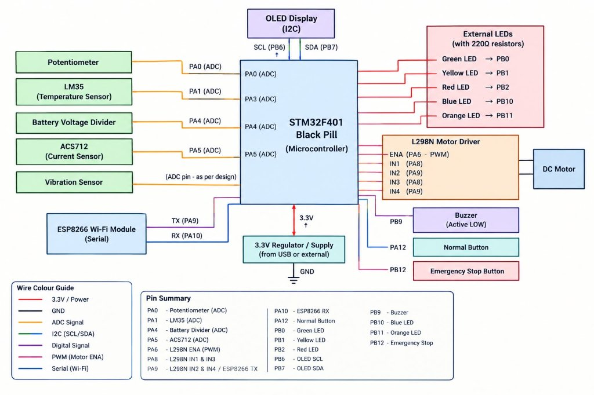

# ForgeSense: STM32 Machine Monitoring & Control System

[-blue.svg)](https://www.st.com/en/microcontrollers-microprocessors/stm32f401cc.html)
[-green.svg)]()
[-orange.svg)]()

ForgeSense is a tabletop intelligent machine condition monitoring and motor drive supervisory platform developed on the **STM32F401CCU6 (Black Pill)** microcontroller. It integrates analog sensing, closed-loop PWM motor control, an I2C OLED display, an active-LOW buzzer, a hardware emergency-stop interlock, and real-time live telemetry streaming to a Web dashboard over UART/Wi-Fi.



---

## 1. Project Directory Structure

```text
Embedded-systems-project/
├── firmware/
│   ├── main.c              # Full integrated Keil firmware (Sensors, OLED, Motor PWM, E-Stop, USART2)
│   └── motor_control.c     # Standalone potentiometer motor speed driver
├── web/
│   └── index.html          # Live Web Serial UART Telemetry Dashboard (Open in Chrome/Edge)
├── esp8266/
│   └── esp8266_wifi.ino    # Optional ESP8266 Wi-Fi serial bridge firmware
├── hardware/
│   ├── ForgeSense_Architecture_Diagram.jpg   # Circuit connection diagram
│   └── WIRING.md           # Pin connections and electrical wiring guide
└── README.md               # Quickstart: Build, flash, connect, and run
```

---

## 2. Hardware Wiring Quick Reference

| Sensor / Module | Signal | STM32 Pin | Function |
|:---|:---|:---:|:---|
| **Speed Potentiometer** | Wiper | `PA0` | `ADC1_IN0` (0–3.3V analog speed setpoint) |
| **LM35 Temperature** | OUT | `PA1` | `ADC1_IN1` (10 mV/°C analog temperature) |
| **Battery Divider** | Scaled OUT | `PA4` | `ADC1_IN4` (1:2 voltage divider) |
| **ACS712 Current** | OUT | `PA5` | `ADC1_IN5` (Motor current sensor) |
| **L298N Motor Driver** | ENA / ENB | `PA6` | `TIM3_CH1` PWM (1 kHz motor speed control) |
| **L298N Motor Driver** | IN3 | `PA8` | Motor direction 1 |
| **L298N Motor Driver** | IN4 | `PA9` | Motor direction 2 |
| **UART Telemetry (USB/ESP)**| RX | `PA2` | `USART2_TX` (9600 Baud, 8-N-1) |
| **UART Telemetry (USB/ESP)**| TX | `PA3` | `USART2_RX` |
| **SSD1306 OLED (0x3C)** | SCL, SDA | `PB6`, `PB7` | `I2C1` (100 kHz standard mode) |
| **MPU6050 IMU (0x68)** | SCL, SDA | `PB6`, `PB7` | `I2C1` (Shared with OLED) |
| **Active-LOW Buzzer** | Signal | `PB9` | 3.3V = Silent, 0V = Sounding |
| **Status LEDs (Red/Green/Yellow)**| Anodes | `PB0`, `PB1`, `PB2` | 220 Ω resistors to ground |
| **Emergency Stop Button**| Contact | `PB12` | Active-LOW (Internal pull-up enabled) |
| **Operator Button** | Contact | `PB5` | Active-LOW (Internal pull-up enabled) |
| **Onboard User LED** | Onboard | `PC13` | Active-LOW (5 Hz emergency blink) |

> See [hardware/WIRING.md](hardware/WIRING.md) for complete electrical specifications and power supply rules.

---

## 3. How to Build & Flash with Keil MDK

1. **Open Keil MDK (µVision)**:
   - Create a new project or open your existing project targeting **STM32F401CCUx**.
2. **Add Files**:
   - Add `firmware/main.c` to your project source group.
   - Include CMSIS device headers (`stm32f4xx.h`).
3. **Configure Target Options (`Alt + F7`)**:
   - **Target**: Set IROM1: `0x08000000`, IRAM1: `0x20000000`.
   - **C/C++**: Preprocessor defines: `STM32F401xC`.
   - **Debug**: Select **ST-Link Debugger** (or CMSIS-DAP). Under *Settings* -> *Flash Download*, ensure **Reset and Run** is checked.
4. **Compile & Download**:
   - Click **Build (`F7`)**. Verify 0 errors, 0 warnings.
   - Click **Download (`F8`)** to flash the code to the STM32 via ST-Link.

---

## 4. How to Run the UART Web Dashboard

1. **Connect Hardware**:
   - Connect STM32 `PA2` (`USART2_TX`) to the `RX` pin of a USB-to-UART converter (CP2102 / FTDI / CH340).
   - Connect `GND` of the USB-UART converter to STM32 `GND`.
   - Plug the USB-UART converter into your PC.
2. **Open Dashboard**:
   - Double-click [`web/index.html`](web/index.html) to open it in **Google Chrome** or **Microsoft Edge**.
3. **Connect**:
   - Click **"Connect Serial Port"**.
   - Select your USB-UART adapter COM port from the browser prompt.
   - The dashboard will immediately start streaming live gauges for Potentiometer, Motor Speed (%), PWM Duty, Direction, Temperature, Battery Voltage, Current, and Emergency Stop Status!

---

## 5. Emergency Stop Interlock Behavior

When the emergency stop button on `PB12` is pressed:
- **Motor**: Instantly stops (`TIM3->CCR1 = 0`, direction pins de-energized).
- **Buzzer**: Silenced immediately (`PB9` driven HIGH).
- **Display**: All live readings are zeroed on the OLED screen.
- **Safety Lockout**: The system enters an irreversible 5 Hz lockout blink on `PC13` and `PB0` (Red LED).
- **Web Console**: The status banner turns red and displays `E-STOP: LATCHED`.
