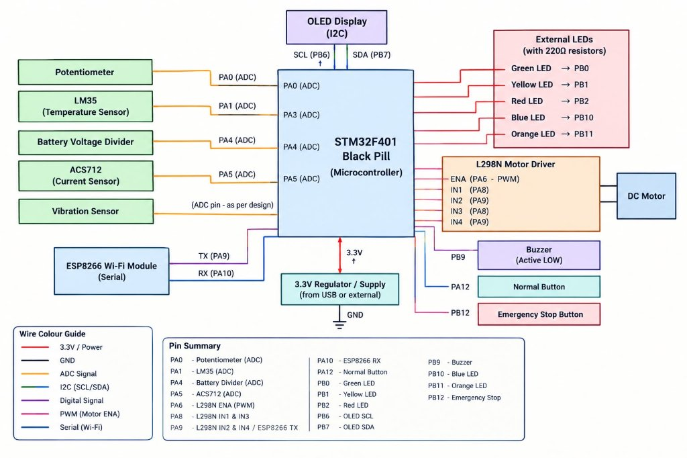

# ForgeSense Hardware Wiring & Connection Guide

## 1. Pin Interconnect Master Table

| Component | Pin / Signal | STM32 Pin | Mode | Connection Details |
|:---|:---|:---:|:---:|:---|
| **Speed Potentiometer** | Wiper | `PA0` | ADC1_IN0 | Left pin -> 3.3V, Right pin -> GND, Wiper -> PA0 |
| **LM35 Temp Sensor** | Vout | `PA1` | ADC1_IN1 | VCC -> 3.3V, GND -> GND, OUT -> PA1 (10 mV/°C) |
| **Battery Divider** | Scaled OUT | `PA4` | ADC1_IN4 | 1:2 Divider (two equal resistors, e.g. 10 kΩ) |
| **ACS712 Current Sensor** | Vout | `PA5` | ADC1_IN5 | VCC -> 3.3V, GND -> GND, OUT -> PA5 |
| **L298N Motor Driver** | ENA / ENB | `PA6` | TIM3_CH1 | **Remove ENA/ENB jumper**, connect to PA6 (1 kHz PWM) |
| **L298N Motor Driver** | IN3 | `PA8` | GPIO Out | Motor Direction 1 |
| **L298N Motor Driver** | IN4 | `PA9` | GPIO Out | Motor Direction 2 |
| **USB-UART / ESP8266** | RX | `PA2` | USART2_TX | Connect to USB-TTL RX or ESP8266 RX (9600 Baud) |
| **USB-UART / ESP8266** | TX | `PA3` | USART2_RX | Connect to USB-TTL TX or ESP8266 TX |
| **SSD1306 OLED Display** | SCL | `PB6` | I2C1_SCL | VCC -> 3.3V, GND -> GND, SCL -> PB6 |
| **SSD1306 OLED Display** | SDA | `PB7` | I2C1_SDA | SDA -> PB7 (Address: `0x3C`) |
| **MPU6050 Accelerometer** | SCL | `PB6` | I2C1_SCL | Shares SCL with OLED |
| **MPU6050 Accelerometer** | SDA | `PB7` | I2C1_SDA | Shares SDA with OLED (Address: `0x68`, AD0 -> GND) |
| **Active-LOW Buzzer** | I/O | `PB9` | GPIO Out | **Active-LOW** (3.3V = Silent, 0V = Sounding) |
| **Status LED: Red** | Anode | `PB0` | GPIO Out | 220 Ω series resistor to GND |
| **Status LED: Green** | Anode | `PB1` | GPIO Out | 220 Ω series resistor to GND |
| **Status LED: Yellow** | Anode | `PB2` | GPIO Out | 220 Ω series resistor to GND |
| **Normal Pushbutton** | Pin 1 | `PB5` | GPIO In | Pin 2 to GND (Internal pull-up enabled) |
| **Emergency Stop Button** | Pin 1 | `PB12` | GPIO In | Pin 2 to GND (Internal pull-up enabled) |
| **Onboard User LED** | Onboard | `PC13` | GPIO Out | Active-LOW (blinks at 5 Hz on emergency stop) |

---

## 2. Power Supply & Grounding (Critical)

1. **Common Ground**:
   - The STM32 `GND`, L298N `GND`, ESP8266/USB-TTL `GND`, and Motor Power Supply negative **MUST all be tied together**.
2. **Motor Power**:
   - Supply the DC motor from an external 9V–12V battery or adapter directly to the L298N power terminal block. Do not power the motor from the STM32 3.3V rail.
3. **Logic Supply**:
   - STM32 is powered via USB-C or 5V rail. Sensors (LM35, Potentiometer, OLED, MPU6050) run off the STM32 3.3V pin.
